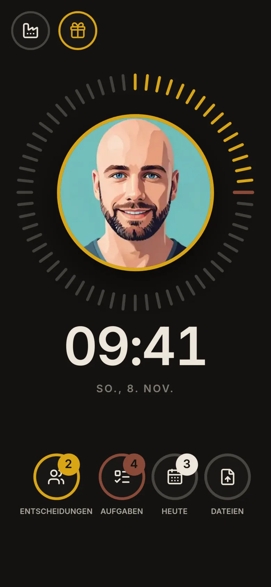
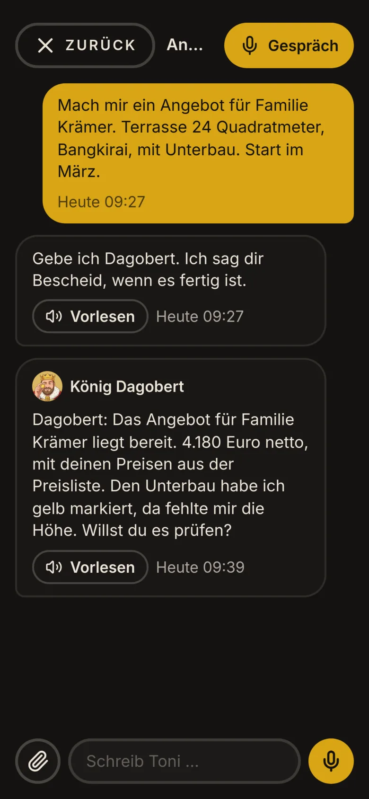
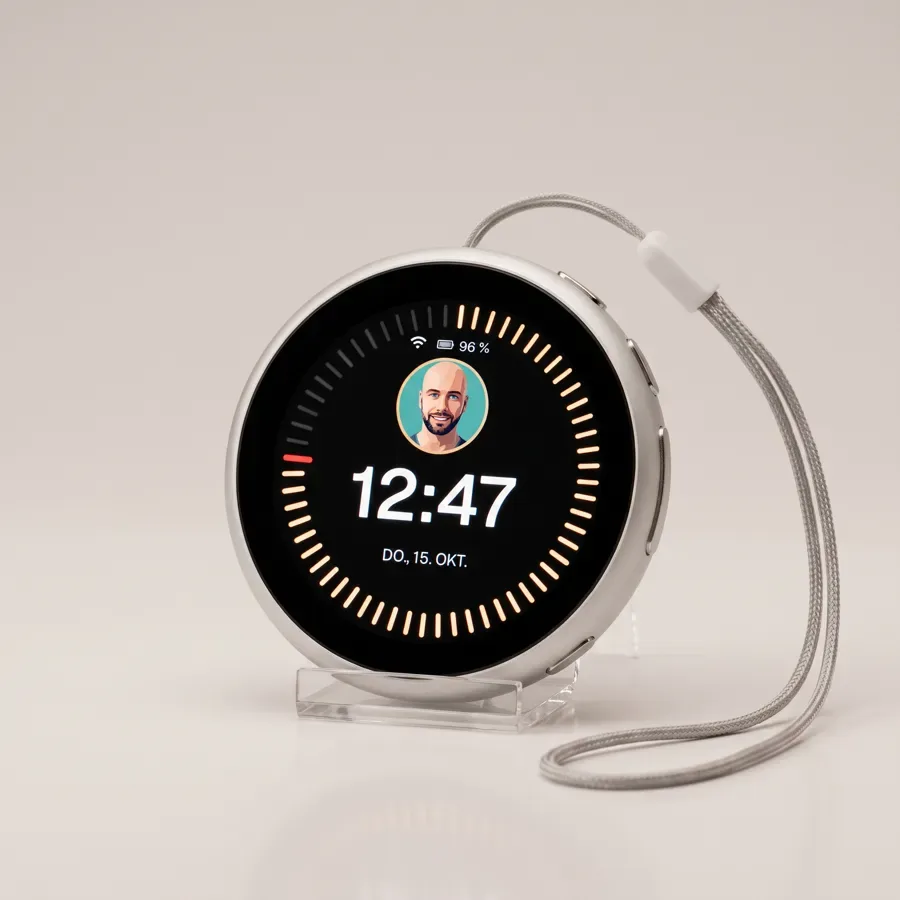
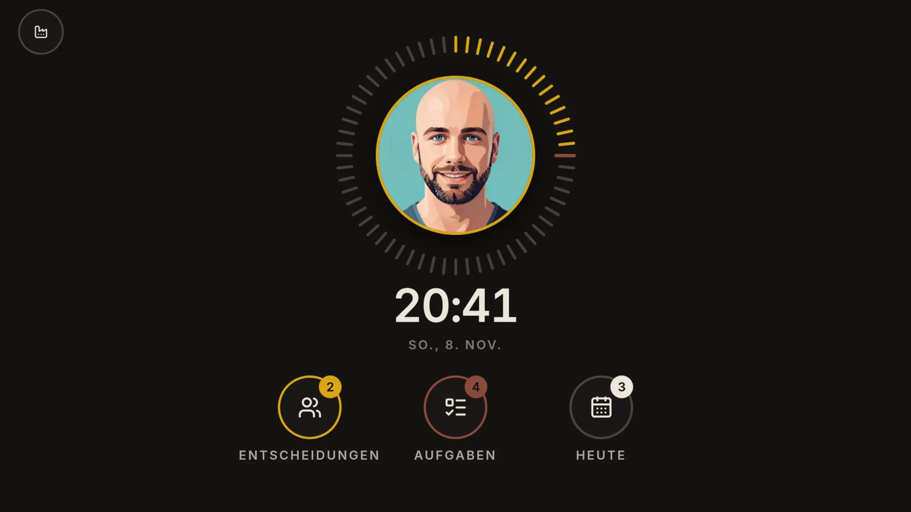
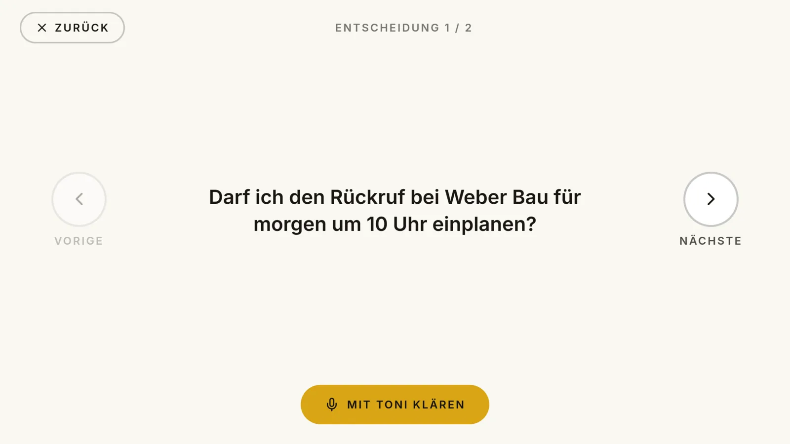
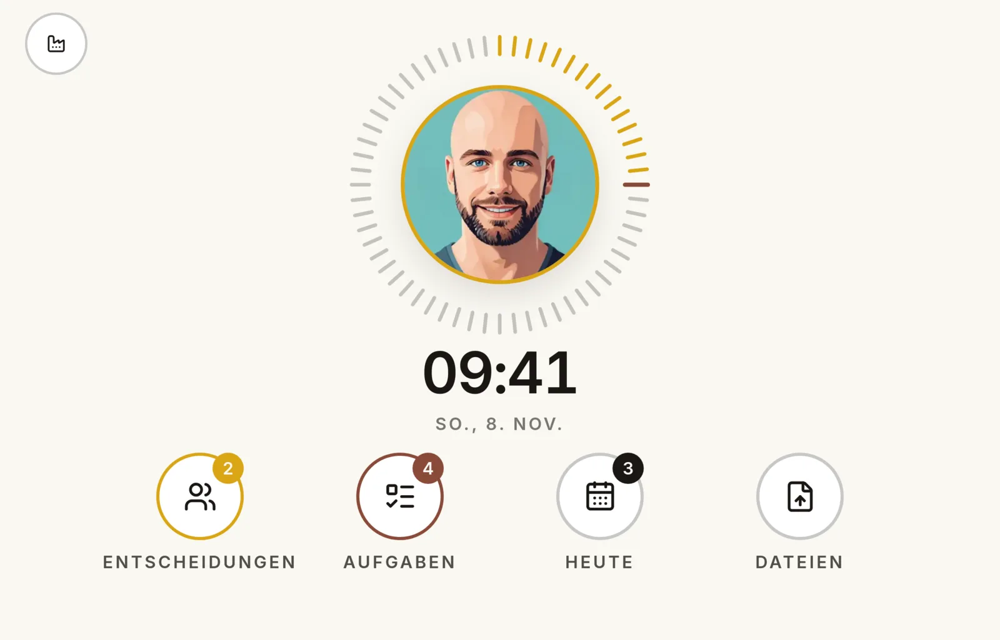
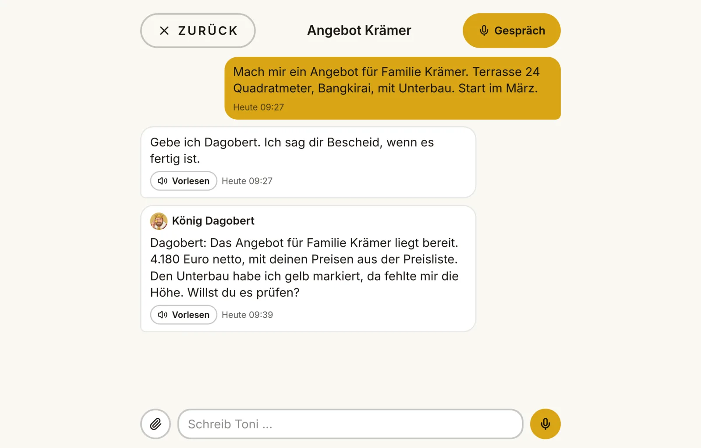

# Toni SDK for Node.js

[](https://www.npmjs.com/package/toni-sdk) [](https://nodejs.org) [](LICENSE) [](https://ki-markt.com/api-referenz)

**The AI agent for the self-employed and for business owners.** Toni already knows how a small company works: customers and enquiries, offers, invoices, content, knowledge, and AI co-workers that take over recurring jobs. 260+ business functions are built in. There is no server to run and no model key to manage. This SDK gives you the agent loop, every function as a typed method, an OpenAI-compatible model gateway and a terminal client.

Use Toni on his own, as the hosted alternative to [Hermes Agent](https://github.com/NousResearch/hermes-agent) and [OpenClaw](https://github.com/openclaw/openclaw). Or keep your OpenClaw or Hermes setup and [plug Toni in](#use-toni-inside-openclaw-or-hermes-agent) as the part that knows your business.

[Deutsche Fassung](README.de.md) · [PHP](https://github.com/stefanhaab/toni-sdk-php) · [Python](https://github.com/stefanhaab/toni-sdk-python) · [API reference](https://ki-markt.com/api-referenz) · [ki-markt.com](https://ki-markt.com)

```bash
npm install toni-sdk
```

```ts
import { Toni } from 'toni-sdk';

const toni = new Toni(); // reads TONI_API_KEY

const result = await toni.agent({ areas: ['crm'] }).run('Who got in touch this week, and who is still waiting for an answer?');
console.log(result.text);
```

Get a key (`km_live_…`) in your account under "API" at [ki-markt.com](https://ki-markt.com). New accounts start with test credit.

## What Toni can do

Toni is the digital assistant of a company. You talk to him the way you would talk to a chief of staff: by voice, by chat, on the phone, in the car, on your wrist. He answers in your language, works in the name of your company, and asks before he does anything that cannot be undone.

### He knows the company

Most assistants start from zero in every conversation. Toni starts from context that the platform builds up once and keeps current:

- **Interviews**: you tell him in a conversation what the company does, for whom, and what problems it solves. Everything else draws on this.
- **Knowledge graph**: leads, appointments, offers, books, courses and interviews are linked, so "who was that customer with the terrace?" has an answer.
- **Voice profile**: how you speak and write, so texts sound like you and not like a template.
- **Business model**: what you earn money with and how offers are calculated.
- **Audience**: emotional drivers of your customers (Limbic types), search terms with intent, and the story filter that defines how your story is told.
- **Handbook, glossary, expertise, testimonials**: the working instructions and proof points of the company.

### He does the work

- **Customers and sales**: leads with their origin, contacts, appointments and tasks; offers and quotes drafted from the business model; invoice drafts; a look at open and overdue invoices.
- **Customer support**: messages from e-mail, shop platforms, comments and messengers in one place, with prepared answers.
- **Tasks, reminders and notes**: say "remind me on Friday to call Weber" or "that's done" and it is on the list or off it.
- **Content**: landing pages, portals, digital business cards, QR codes with tracking, campaigns. Books, audiobooks, podcasts and courses come from the same source as everything else: your interviews, your voice, your offer.
- **Editorial engine**: finds what people search for, proposes content ideas, and lets your pages grow once you approve.
- **Conversations with your customers**: chat agents that answer on your website, speak in voice chat and pick up the phone.
- **Goals**: you set the goal, Toni tracks the actual value, the forecast and what is being done about it.

### AI co-workers

You describe a job once, and an AI co-worker does it from then on: on a schedule, or when something happens, such as a new lead, an incoming mail or a paid invoice. Each one has steps, guardrails and a log of every run. Reading happens on its own. Anything that writes, sends or publishes waits for your yes unless you allowed it explicitly. You can try every change as a dry run first, where nothing is written.

### Where you reach him

| | |
|---|---|
| **Toni App** — on your phone. One tap to speak, record a voice note or chat. Decisions, tasks, today's appointments and files are one button each. Upload a file and tell Toni what to do with it. |   |
| **Toni Watch** — a round device on a band or on the wall. Speak an idea the moment you have it; the ring shows whether Toni is listening, thinking or needs you. |   |
| **Toni Car** — on the screen of your car. Large buttons, large type, made for a glance: Toni asks a question, you answer by voice or with one tap. | <br> |
| **Toni Desktop** — on your computer. The same Toni with room for longer chats; drag files in and he reads them. | <br> |

The screens show the real interfaces with invented sample data. Toni is also there in the web chat, on the phone and on an office dashboard for the wall.

### What keeps it safe

- **One company per key**: company and person always come from the key, never from the request.
- **Four rights per key**: read, write, publish, delete. A key has none until you grant them.
- **A human confirms** deleting and publishing. Neither the API nor the agent in this SDK lets a model confirm for itself.
- **Privacy gate**: on by default for every key. Personal data in a text is replaced before a model sees it and put back in the answer.
- **Pay per use**: prepaid credit, three model sizes, a monthly limit per key if you want one.

With this SDK you use all of that from your own code.

## Toni, Hermes Agent, OpenClaw

Hermes Agent and OpenClaw are open-source agents you host yourself. Toni is a hosted platform you call. Pick by what you want to own.

| | Toni | Hermes Agent | OpenClaw |
|---|---|---|---|
| Runs on | Hosted, you call an API | Your machine or server | Your machine or server |
| Setup | `npm install`, one key | Install, configure, keep running | Install, onboard, keep a daemon running |
| Models | Three sizes included, pay per use | Bring your own model keys | Bring your own model keys, or local models |
| Tools | 260+ business functions, tenant-safe | Skills the agent writes, community skills | Community skills |
| Business data | CRM, offers, invoices, content, knowledge graph included | You connect it | You connect it |
| Destructive actions | Blocked unless a human confirms | Up to your setup | Up to your setup |
| Personal data | Privacy gate replaces it before a model sees it | Up to your setup | Up to your setup |
| Where you talk to it | Toni App, Watch, Car, Desktop, phone, web chat | Telegram, Discord, Slack, WhatsApp, terminal | WhatsApp, Telegram, Slack and 20+ more, native apps |
| Source | SDK is MIT, platform is hosted | MIT, fully open | MIT, fully open |

Choose Hermes Agent or OpenClaw if you want everything on your own hardware and a personal assistant in your chat apps. Choose Toni if you are self-employed or run a company and want an agent that already works with your customers, offers and invoices, without operating it. You don't have to choose: the next section shows how to use both.

## Use Toni inside OpenClaw or Hermes Agent

Toni has a hosted MCP endpoint. Your OpenClaw or Hermes agent keeps its chats, its memory and its skills, and gets Toni as the colleague who knows the company. There is nothing to install.

- **Address:** `https://app.landingpage.tools/mcp`
- **Key:** create a connector key (`lpt_…`) in the downloads area of your account, under "Connect an AI assistant". It is a different key than the API key of this SDK.
- **Tools:** `toni` hands a task to Toni, who works with the company's context and remembers the conversation. `suchen` searches the company's knowledge. `katalog` and `ausfuehren` reach the platform functions directly. Rights and the confirmation for deleting and publishing apply here as well.

Hermes Agent, in `~/.hermes/config.yaml`:

```yaml
mcp_servers:
  toni:
    url: "https://app.landingpage.tools/mcp"
    headers:
      Authorization: "Bearer lpt_…"
```

OpenClaw, in the `mcp.servers` block of your config (check it with `openclaw mcp probe`):

```json
{
  "mcp": {
    "servers": {
      "toni": {
        "url": "https://app.landingpage.tools/mcp",
        "transport": "streamable-http",
        "headers": { "Authorization": "Bearer lpt_…" }
      }
    }
  }
}
```

The same endpoint works in Claude, ChatGPT and any other MCP host.

## Coming from OpenClaw or Hermes Agent

| What you know | In Toni |
|---|---|
| Skills | 260+ built-in business functions; add your own with `tools` |
| Memory, `SOUL.md`, `USER.md` | Interviews, voice profile, knowledge graph and notes, kept on the platform |
| Cron and scheduled automations | AI co-workers that run on a schedule or when something happens |
| Subagents | AI co-workers under Toni, each with steps, guardrails and a run log |
| Command approval | Four rights per key, and a human confirms deleting and publishing |
| Model providers and keys | Three sizes included, prepaid, pay per use |
| Gateway and chat channels | Toni App, Watch, Car, Desktop, phone and web chat |
| A daemon on your machine | Nothing to run |

## The agent

```ts
const agent = toni.agent({
  areas: ['crm', 'offers'],          // functions of these areas become tools
  allow: ['lesen', 'schreiben'],     // default is ['lesen']: read only
  instructions: 'You work for a machine builder. Answer in English.',
  onStep: (s) => console.log('→', s.tool, s.args),
});

const first = await agent.run('Create a lead for Mira Example, mira@example.com.');
const next = await agent.run('And draft an offer for her.', { messages: first.messages });
```

- **Without `areas`** the agent searches the whole catalog itself (two tools: search, call). Good for open questions.
- **Rights** follow four levels: `lesen` (read), `schreiben` (write), `veroeffentlichen` (publish), `loeschen` (delete). The agent only sees functions of the levels you allow, and the key needs the same right in your account.
- **Deleting and publishing** additionally need `onConfirm`. The model cannot confirm for itself:

```ts
toni.agent({
  areas: ['books'],
  allow: ['lesen', 'loeschen'],
  onConfirm: async (call) => confirm(`${call.title}: ${JSON.stringify(call.args)}?`),
});
```

- **Your own tools** sit next to the platform functions:

```ts
toni.agent({
  tools: [{
    name: 'stock',
    description: 'Stock level of an article',
    parameters: { type: 'object', properties: { sku: { type: 'string' } }, required: ['sku'] },
    execute: ({ sku }) => warehouse.stock(sku),
  }],
});
```

`run()` returns `text`, `steps` (every tool call with arguments, result and duration), `messages`, `usage` and `finish`.

## AI co-workers that run on their own

Agents you build on the platform keep running without your process: on a schedule or on events such as a new lead or an incoming mail.

```ts
const { agent_id } = await toni.baukasten.agentEntwurf({ name: 'Check new leads', anweisungen: 'Rate every new lead and note why.' });
const { lauf_id } = await toni.baukasten.agentStarten({ agent_id, simulation: true });   // dry run: nothing is written
const status = await toni.baukasten.agentLaufStatus({ lauf_id });
```

## Every function as a method

```ts
const leads = await toni.crm.getLeads({ status: 'new', limit: 10 });
const book = await toni.books.createBook({ title: 'Less office' });
await toni.books.deleteBook({ book_id: 12, bestaetigt: true });

await toni.platform.call('crm', 'get_leads', { limit: 10 });   // generic form
```

30 areas, generated from the OpenAPI document, with parameter docs in your editor. Function names and docs are German, as in the API. A function returns `{ success, data }`; a business error such as an unknown id comes back as `{ success: false, error }` and does not throw.

## Model gateway (OpenAI-compatible)

```ts
const text = await toni.ask('Summarise in two sentences what a voicebot is.');

const stream = await toni.chat.completions.create({
  model: 'toni-mittel',                       // toni-leicht · toni-mittel · toni-schwer
  messages: [{ role: 'user', content: 'Hello' }],
  stream: true,
});
for await (const chunk of stream) process.stdout.write(chunk.choices[0]?.delta?.content ?? '');

await toni.embeddings.create({ input: ['one', 'two'] });
await toni.audio.transcriptions.create({ file: './call.mp3', language: 'de' });
await toni.images.generate({ prompt: 'A workshop at sunrise' });

const video = await toni.videos.create({ prompt: 'A drone over a factory roof', seconds: 5 });
await toni.videos.wait(video.id);
const mp4 = await toni.videos.content(video.id);

await toni.prices();   // sizes and prices, no key needed
```

Already using the OpenAI library? Point it at `https://api.ki-markt.com/v1` with your Toni key.

## Terminal

```bash
export TONI_API_KEY=km_live_…
npx toni "Which invoices are overdue?"
npx toni --bereiche crm --schreiben      # conversation, may create and change
npx toni funktionen lead                 # browse the catalog
```

## Errors

```ts
import { ToniApiError, RateLimitError, PermissionError } from 'toni-sdk';

try {
  await toni.crm.createLead({ data: { email: 'mira@example.com' } });
} catch (e) {
  if (e instanceof PermissionError) console.log(e.code); // recht_fehlt
  else if (e instanceof ToniApiError) console.log(e.status, e.code, e.message);
  else throw e;
}
```

`AuthenticationError` (401), `InsufficientCreditError` (402), `PermissionError` (403), `ConfirmationRequiredError` (409), `RateLimitError` (429), `ToniConnectionError` (no answer). Reads are retried on 429 and 5xx; writing platform calls are never retried on their own.

## Options

```ts
new Toni({ apiKey, baseUrl, timeout: 120_000, maxRetries: 2, fetch, headers });
```

Environment: `TONI_API_KEY` (or `KM_KEY`), `TONI_BASE_URL`. Node.js 18 or newer, no dependencies.

## Realtime voice

```ts
const call = await toni.realtime.connect({ instructions: 'You answer the phone for a workshop.', voice: 'marin' });
call.sendAudio(pcmChunk);                 // 24 kHz PCM by default
for await (const event of call) {
  // audio and transcripts arrive as events; see the API reference for the types
}
call.close();
```

Billed in ten-second steps. Needs a WebSocket: built in from Node.js 22, before that pass the class from the `ws` package as `WebSocket`. Toni only speaks while audio comes in, so send silence during pauses.

## Development

```bash
npm install
npm run generate     # rebuild src/generated from the live OpenAPI document
npm test
```

MIT
